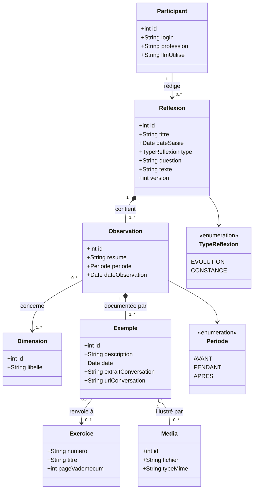
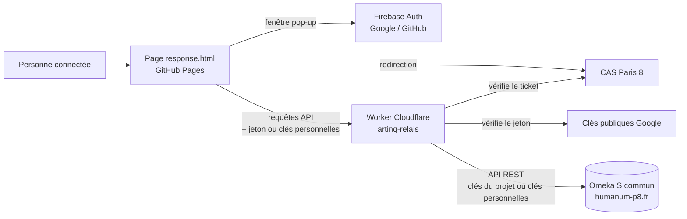
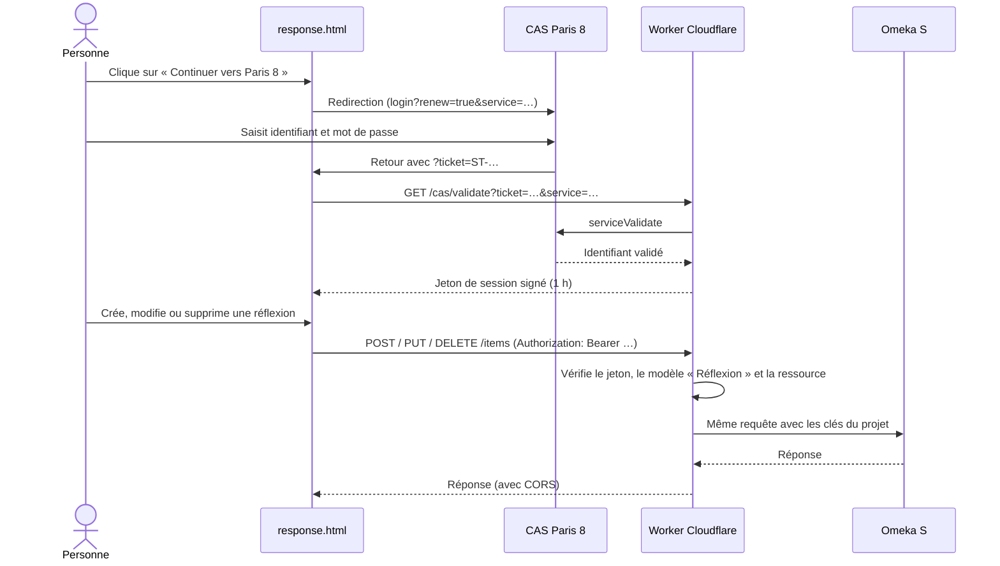

# Diagrammes — Ex11 « Tracking Shifts »

Ce fichier contient trois diagrammes :

1. le **diagramme de classes** du modèle de données ;
2. le **schéma d’architecture** (page web, Worker Cloudflare, Omeka S, authentification) ;
3. le **diagramme de séquence** d’une écriture (créer, modifier, supprimer une réflexion).

## 1. Diagramme de classes

### État d’avancement

| Classe | État | Remarque |
|---|---|---|
| `Reflexion` | **Implémentée** | Créer, lire, modifier, supprimer depuis `response.html` |
| `Participant` | Prévue | Pas encore de lien auteur ↔ réflexion |
| `Observation`, `Exemple` | Prévues | Pour l’instant, le texte de la réponse contient directement les exemples |
| `Dimension`, `Exercice`, `Media` | Prévues | — |

### Correspondance `Reflexion` ↔ propriétés Omeka S

| Attribut | Propriété Omeka S (essayée dans cet ordre) | Champ de la page |
|---|---|---|
| `titre` | `dcterms:title` | Titre |
| `dateSaisie` | `artinq:date`, sinon `artinq:dateSaisie` | Date de saisie |
| `type` | `artinq:type`, sinon `artinq:typeReflexion` | Type |
| `question` | `artinq:description`, sinon `artinq:question` | Question |
| `texte` | `artinq:texte` | Votre réponse |
| `version` | `artinq:version` | Version |

Classe de ressource : `artinq:Reflexion`. Modèle de ressource : « Artificial Inquiries – Réflexion ».

Questions proposées par défaut (valeurs de `question`) :

- `EVOLUTION` : « Comment votre pratique a-t-elle évolué ? »
- `CONSTANCE` : « Quels aspects de votre pratique sont restés constants ? »

## Dimensions prévues (valeurs initiales)

`technique`, `professionnelle`, `émotionnelle`, `éthique`, `sociale`, `autre`

## 2. Architecture

Le Worker ajoute l’autorisation CORS que le serveur de l’université ne donne pas, vérifie l’identité, puis relaie vers Omeka S.

| Connexion | Preuve envoyée au Worker | Clés Omeka utilisées pour écrire |
|---|---|---|
| CAS Paris 8 | Jeton signé par le Worker, valable 1 heure | Clés du projet (secrets du Worker) |
| Google / GitHub | Jeton d’identité Firebase, renouvelé automatiquement | Clés du projet (secrets du Worker) |
| Clés API Omeka S | En-têtes `X-Omeka-Key-Identity` et `X-Omeka-Key-Credential` | Clés personnelles de la personne |

## 3. Séquence d’une écriture (CAS Paris 8)

Les connexions Google et GitHub suivent le même schéma, sans la redirection CAS : la page envoie directement le jeton Firebase au Worker.
